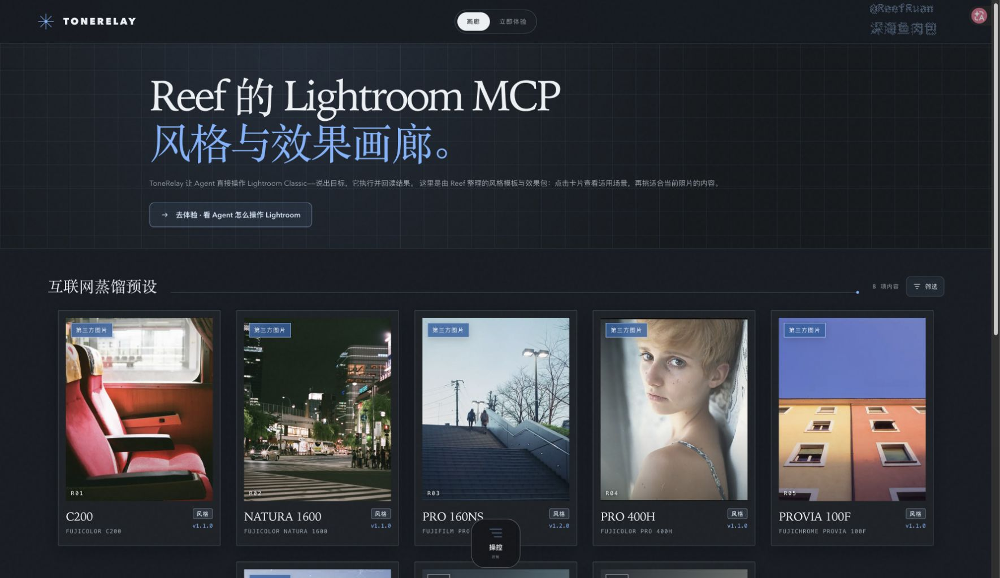
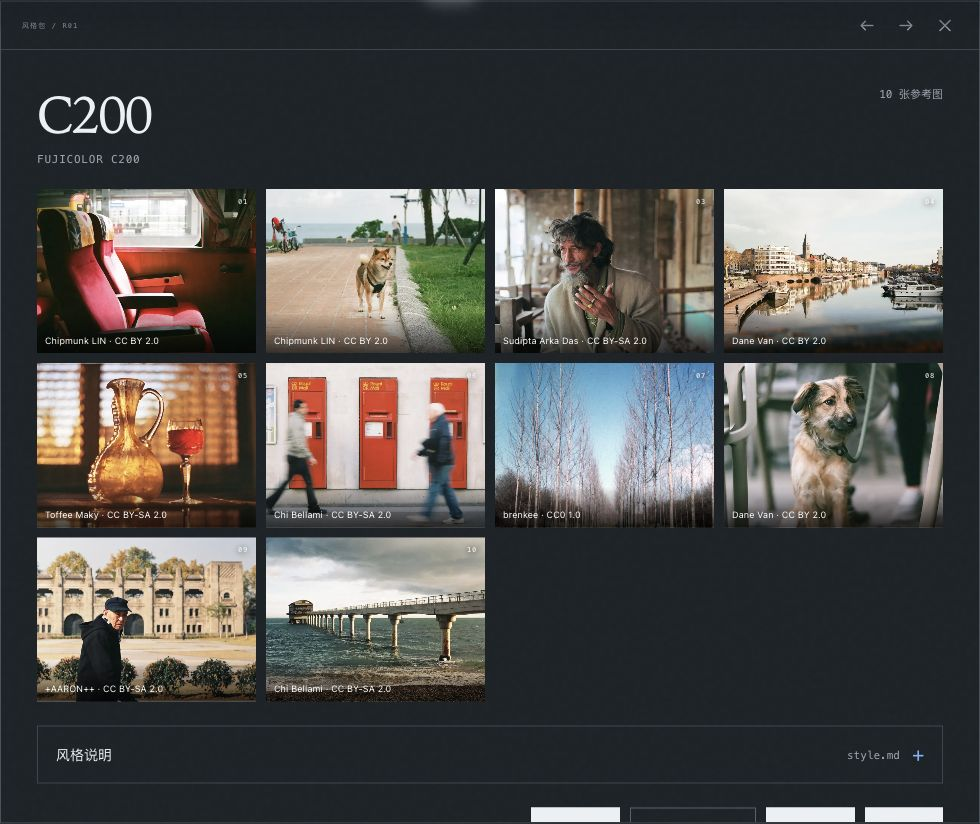
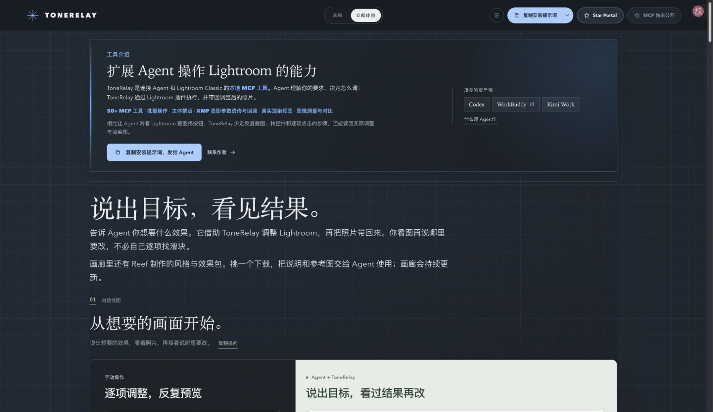

# ToneRelay Portal — Lightroom MCP Style and Effects Gallery

[中文](README.md) | [English](README.en.md)

A place to explore reference photos, color-grading styles, and conversational editing for photography and **Adobe Lightroom Classic**. Find the colors and lighting you like, then bring that direction into a conversation with your Agent.

ToneRelay connects AI agents to Lightroom Classic through the Model Context Protocol (MCP), for conversational AI photo editing, reference-based color grading, and photography workflows. This repository is its website and style gallery—not the MCP runtime.

[Open the gallery](https://reefruan.github.io/tonerelay-portal/?lang=en#gallery) · [Explore photo editing](https://reefruan.github.io/tonerelay-portal/?lang=en#experience) · [Install Lightroom MCP](https://github.com/ReefRuan/tonerelay-lightroom-mcp/blob/main/INSTALL.en.md) · [Star the MCP repository](https://github.com/ReefRuan/tonerelay-lightroom-mcp) · [Bilibili homepage](https://space.bilibili.com/2869626) · [Contact the author](https://reefruan.github.io/tonerelay-portal/contact.html?lang=en)



<sub>An actual screenshot of the website. The gallery photos are independent photographic works used as style references. They were not generated by ToneRelay and do not promise results from applying a preset. See “Image sources and licensing” below for photographers and licenses.</sub>

## Find the colors you like, then start editing

Browse six film-style packs in the [online gallery](https://reefruan.github.io/tonerelay-portal/?lang=en#gallery): FUJICOLOR C200, NATURA 1600, PRO 160NS, PRO 400H, PROVIA 100F, and SUPERIA X-TRA 400.

Open a card to explore reference photos, color relationships, suitable scenes, and sources. Download a pack you like, then share its notes and reference images with your Agent. No login or backend setup is required.



Style packs contain Markdown notes and reference images. They are **not Lightroom presets**, and downloading one does not install MCP. Automatic installation by pack ID is not currently promised. See [Style and effects packs](style-packs/README.md) for the full catalog, ZIP files, and individual image credits.

The gallery also offers two effects packs explicitly labeled as candidates: [Adaptive Skin-Tone Protection E01](https://reefruan.github.io/tonerelay-portal/?lang=en&preset=skin-tone-adaptive-fidelity#gallery) and [Luminous Mist Portrait E02](https://reefruan.github.io/tonerelay-portal/?lang=en&preset=luminous-mist-portrait#gallery). Their paired Lightroom results have not yet been validated. E02 distributes only text and links to photos on their original sites; it does not include third-party photo files.

## See the result, then discuss the next adjustment

Once ToneRelay is connected, your Agent can read the current photo and folder previews, adjust Develop settings, retrieve Lightroom’s actual rendered result, and keep refining it based on your feedback. Reference-based color matching, subject masks, and batch star-rating organization are also available; specific capabilities depend on the installed version.



> “Use this image as a color reference and make a first pass.”
>
> “Lift the shadows a little more, keep skin tones from going yellow, and show me a before-and-after comparison.”

<p align="center">
  <a href="https://reefruan.github.io/tonerelay-portal/?lang=en#experience"></a>
</p>

<sub>The image above was recaptured from the current Portal showcase on 2026-10-19. Its Lightroom and Agent conversation images come from the author’s earlier real workflow; the editing was not rerun for this capture. [More real workflow images and image sources](public/experience/SOURCES.md). The Agent determines the editing direction, while ToneRelay executes changes and retrieves results. Not every photo can achieve the same result in one step.</sub>

## Get started

1. [Browse the gallery](https://reefruan.github.io/tonerelay-portal/?lang=en#gallery), or start with the [conversational editing introduction](https://reefruan.github.io/tonerelay-portal/?lang=en#experience).
2. Start with the MCP repository’s [installation guide](https://github.com/ReefRuan/tonerelay-lightroom-mcp/blob/main/INSTALL.en.md), or copy the [installation prompt](docs/install-prompt.en.md) retained in Portal to your Agent. It will first check for an existing local installation, then verify the official source, access permissions, a pinned version, and the installation instructions.
3. After installation is working and verified, open Lightroom Classic and the target Catalog, then begin with “Show me the current photo.” For help, see Portal’s [FAQ](docs/faq.en.md); for removal, see the [uninstallation prompt](docs/uninstall-prompt.en.md).

MCP is currently a source preview. Follow the [MCP repository’s installation guide](https://github.com/ReefRuan/tonerelay-lightroom-mcp/blob/main/INSTALL.en.md), and pin downloads to a verifiable tag or full commit rather than treating the changing `main` branch as a version number. Copying a prompt from the website does not mean installation is complete. If a healthy local installation already exists, follow the prompt to verify and reuse it. Portal’s installation prompt, FAQ, and uninstallation instructions remain in their original locations, without migration or directory restructuring.

## Portal and Runtime responsibilities

| Repository | Purpose |
| --- | --- |
| **This repository: [tonerelay-portal](https://github.com/ReefRuan/tonerelay-portal)** | Product introduction, photography style gallery, style and candidate effects packs, installation prompt and FAQ, and the MCP installation entry point |
| **[tonerelay-lightroom-mcp](https://github.com/ReefRuan/tonerelay-lightroom-mcp)** | The local MCP Runtime, Lightroom plugin, and integration components that connect an Agent with Lightroom Classic; the [installation guide](https://github.com/ReefRuan/tonerelay-lightroom-mcp/blob/main/INSTALL.en.md), [usage guide](https://github.com/ReefRuan/tonerelay-lightroom-mcp/blob/main/USAGE.en.md), and Star entry point are all here |

The website also provides a directly readable [Lightroom MCP guide](https://reefruan.github.io/tonerelay-portal/en/lightroom-classic-mcp/), standalone style and effects pages, and a [sitemap.xml](https://reefruan.github.io/tonerelay-portal/sitemap.xml). These pages make sharing and search-engine access easier; indexing, rankings, and recommendations are determined by each platform.

## Local preview

```bash
pnpm install
pnpm dev
```

The interactive gallery can be previewed directly. Standalone introduction pages are generated during the build. To view the complete site, run `pnpm build`, then `pnpm preview`.

Website code lives in `src/` and `public/`; style and effects packs live in `style-packs/`. The installation prompt, FAQ, and uninstallation prompt remain in this repository’s `docs/` for reading and copying through the website. The main installation guide links to [INSTALL.en.md in the MCP repository](https://github.com/ReefRuan/tonerelay-lightroom-mcp/blob/main/INSTALL.en.md).

## Image sources and licensing

The new screenshots on this page were captured from the Portal website and show its layout, with possible resizing. Third-party photos within the screenshots retain their individual original licenses; taking a screenshot does not make them the project author’s works. Credits for the cover photos visible in the gallery overview and the C200 reference photos are listed below. For other photos in the packs, see each [style-pack `package.json`](style-packs/packages/) and the website’s per-image source links. Sources for actual editing and conversation screenshots are recorded in the [workflow screenshot log](public/experience/SOURCES.md).

<details>
<summary>Gallery overview and C200 detail screenshots: photographers, original images, and licenses</summary>

Five cover photos in the overview:

| Style pack | Photographer / original image | License |
| --- | --- | --- |
| C200 | [Chipmunk LIN — 離鄉 / FUJIFILM C200](https://www.flickr.com/photos/130477966@N06/48806348736) | [CC BY 2.0](https://creativecommons.org/licenses/by/2.0/) |
| NATURA 1600 | [Gemini st. — nightwalk](https://www.flickr.com/photos/79635710@N05/9758617445) | [CC BY 2.0](https://creativecommons.org/licenses/by/2.0/) |
| PRO 160NS | [doca doca — 150315B7528PN160NS](https://www.flickr.com/photos/19924293@N08/16203711663/) | [CC BY 2.0](https://creativecommons.org/licenses/by/2.0/) |
| PRO 400H | [Ustynskyi — Lisa](https://www.flickr.com/photos/99473925@N07/13223092445) | [CC BY 2.0](https://creativecommons.org/licenses/by/2.0/) |
| PROVIA 100F | [Un ragazzo chiamato Bi — 3 colors and the moon](https://www.flickr.com/photos/57688343@N00/18029320402) | [CC BY-SA 2.0](https://creativecommons.org/licenses/by-sa/2.0/) |

Ten reference photos in the C200 details (in the order of the [pack’s source records](style-packs/packages/fuji-film-c200/package.json)):

| No. | Photographer / original image | License |
| --- | --- | --- |
| 01 | [Chipmunk LIN — 離鄉 / FUJIFILM C200](https://www.flickr.com/photos/130477966@N06/48806348736) | [CC BY 2.0](https://creativecommons.org/licenses/by/2.0/) |
| 02 | [Chipmunk LIN — 公園的小柴柴 / FUJIFILM C200](https://www.flickr.com/photos/130477966@N06/48805907483) | [CC BY 2.0](https://creativecommons.org/licenses/by/2.0/) |
| 03 | [Sudipta Arka Das — ...](https://www.flickr.com/photos/34804966@N03/8044297521) | [CC BY-SA 2.0](https://creativecommons.org/licenses/by-sa/2.0/) |
| 04 | [Dane Van — Edit -1-5](https://www.flickr.com/photos/11028609@N05/40348704133) | [CC BY 2.0](https://creativecommons.org/licenses/by/2.0/) |
| 05 | [Toffee Maky — Jug and Glass](https://www.flickr.com/photos/86543134@N03/13442559963) | [CC BY-SA 2.0](https://creativecommons.org/licenses/by-sa/2.0/) |
| 06 | [Chi Bellami — Postbox Trio](https://www.flickr.com/photos/46644449@N02/8128629297) | [CC BY-SA 2.0](https://creativecommons.org/licenses/by-sa/2.0/) |
| 07 | [brenkee — Planned Nature](https://www.flickr.com/photos/55128416@N05/13088517763) | [CC0 1.0](https://creativecommons.org/publicdomain/zero/1.0/) |
| 08 | [Dane Van — Edit -1-9](https://www.flickr.com/photos/11028609@N05/39899830840) | [CC BY 2.0](https://creativecommons.org/licenses/by/2.0/) |
| 09 | [+AARON++ — 中央体育场 / 南京](https://www.flickr.com/photos/50704193@N07/8284339196) | [CC BY-SA 2.0](https://creativecommons.org/licenses/by-sa/2.0/) |
| 10 | [Chi Bellami — RNLI Bembridge Lifeboat Station, Isle of Wight](https://www.flickr.com/photos/46644449@N02/46786107765) | [CC BY-SA 2.0](https://creativecommons.org/licenses/by-sa/2.0/) |

Screenshots do not change the licenses of these photos. When redistributing images, retain their authors, sources, licenses, and notices of changes, and follow any applicable share-alike requirements.

</details>

Author and maintainer: [Reef Ruan (@ReefRuan)](https://github.com/ReefRuan) · [Bilibili](https://space.bilibili.com/2869626). If you enjoy conversational photo editing, please [Star the Lightroom MCP repository](https://github.com/ReefRuan/tonerelay-lightroom-mcp). Copyright (C) 2026 Reef Ruan.

The author’s code and text are licensed under [GNU AGPL-3.0-only](LICENSE); see [license scope](LICENSE-SCOPE.md) for coverage and third-party material exceptions. Photographic works belong to their respective original authors; the repository-level AGPL does not replace their original licenses. ToneRelay is an independent project, not an official Adobe product.
