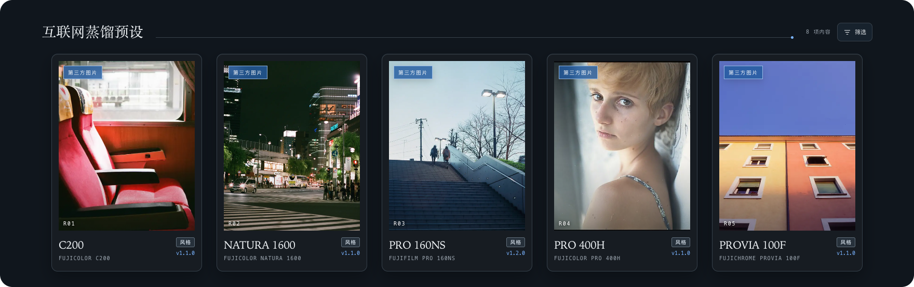

# ToneRelay Portal — Lightroom MCP 风格与效果画廊

[中文](README.md) | [English](README.en.md)

面向摄影与 **Adobe Lightroom Classic** 的参考图、调色风格和对话修图入口。先浏览喜欢的颜色与光影，再把目标带进与 Agent 的对话。

ToneRelay connects AI agents to Lightroom Classic through the Model Context Protocol (MCP), for conversational AI photo editing, reference-based color grading, and photography workflows. This repository is its website and style gallery—not the MCP runtime.

[打开画廊](https://reefruan.github.io/tonerelay-portal/#gallery) · [看看怎样修图](https://reefruan.github.io/tonerelay-portal/#experience) · [安装与使用](https://reefruan.github.io/tonerelay-portal/#experience) · [给 MCP 点 Star](https://github.com/ReefRuan/tonerelay-lightroom-mcp) · [Bilibili 主页](https://space.bilibili.com/2869626) · [联系作者](https://reefruan.github.io/tonerelay-portal/contact.html)

<p align="center">
  <a href="https://reefruan.github.io/tonerelay-portal/#gallery"></a>
</p>

<sub>网页实拍截图。画廊中的照片是独立摄影作品，用作风格参考，不是 ToneRelay 生成的图片，也不是套用预设后的效果承诺。摄影师与许可见下方「图片来源与许可」。</sub>

## 先找到喜欢的颜色，再开始修图

**[推荐先逛风格与效果画廊 →](https://reefruan.github.io/tonerelay-portal/#gallery)** 颜色、光影和参考图比风格名称更直观。点击小图进入画廊，找到喜欢的方向，再带进修图对话。

<a href="https://reefruan.github.io/tonerelay-portal/#gallery"></a>

在[在线画廊](https://reefruan.github.io/tonerelay-portal/#gallery)浏览六个胶片风格包：FUJICOLOR C200、NATURA 1600、PRO 160NS、PRO 400H、PROVIA 100F 与 SUPERIA X-TRA 400。

点开卡片，可以查看参考照片、颜色关系、适用场景和来源；喜欢的包可以单独下载，再把说明和参考图交给 Agent。无需登录，也不需要搭建后端。

<p align="center">
  <a href="docs/assets/readme-style-detail.png"></a>
</p>

风格包提供 Markdown 说明和参考图，**不是 Lightroom 预设**，下载它也不等于安装了 MCP；目前不承诺按包编号自动安装。完整目录、ZIP 与逐图署名见 [风格与效果包](style-packs/README.md)。

画廊还提供两个明确标为候选的效果包：[自适应肤色保护 E01](https://reefruan.github.io/tonerelay-portal/?preset=skin-tone-adaptive-fidelity#gallery) 与[朦胧发光人像 E02](https://reefruan.github.io/tonerelay-portal/?preset=luminous-mist-portrait#gallery)。它们的 Lightroom 成对效果尚待验证；E02 仅分发文字与原站照片链接，不包含第三方照片文件。

## 看结果，继续讨论怎么修

接入 ToneRelay 后，Agent 可以读取当前照片与目录预览、调整显影参数、回读 Lightroom 实际渲染结果，再根据反馈继续精修。还可以结合参考图仿色、主体蒙版与批量星级整理；具体能力以当前安装版本为准。

<p align="center">
  <a href="https://reefruan.github.io/tonerelay-portal/#experience"></a>
</p>

> “参考这张图的颜色，先做一版。”
>
> “暗部再亮一点，肤色别偏黄，给我看前后对比。”

<p align="center">
  <a href="https://reefruan.github.io/tonerelay-portal/#experience"></a>
</p>

<sub>上图来自 Portal 的对话修图展示区；其中的 Lightroom 与 Agent 对话画面来自作者此前的实际工作流，并非为本次文档更新重新执行修图。[更多实际操作画面与图片来源](public/experience/SOURCES.md)。Agent 负责判断目标，ToneRelay 负责执行与回读；不是每张照片都能一键得到相同结果。</sub>

## 怎么开始

1. [浏览画廊](https://reefruan.github.io/tonerelay-portal/#gallery)，或先看[对话修图介绍](https://reefruan.github.io/tonerelay-portal/#experience)。
2. 在[安装与使用](https://reefruan.github.io/tonerelay-portal/#experience)复制完整安装提示词，或直接使用[本文末尾的简短入口](#直接复制安装提示词)。需要逐步操作时，查看 MCP 仓库的[技术安装指南](https://github.com/ReefRuan/tonerelay-lightroom-mcp/blob/main/INSTALL.md)。Agent 会先检查本机已有安装，再核对官方来源、访问权限、固定版本与安装说明。
3. 安装可用并完成验证后，打开 Lightroom Classic 与目标 Catalog，从“看看当前照片”开始。遇到问题可查看 Portal 的 [FAQ](docs/faq.md)，卸载见[卸载提示词](docs/uninstall-prompt.md)。

MCP 已公开，当前为可按固定源码版本安装的源码预览，不代表已发布稳定安装包或完成全平台验收。安装以 [MCP 仓库的指南](https://github.com/ReefRuan/tonerelay-lightroom-mcp/blob/main/INSTALL.md)为准；下载时固定完整提交，标签也须核验其指向的完整提交，不把持续变化的 `main` 当作版本号。网页复制提示词不等于已经完成安装；已有健康本机安装时，可按提示核验并复用。Portal 的安装提示词、FAQ 与卸载说明保留原位，不迁移或改变目录结构。

双源入口分工：[GitHub MCP 源码主源](https://github.com/ReefRuan/tonerelay-lightroom-mcp)／[Gitee MCP 源码备用](https://gitee.com/ReefRuan/tonerelay-lightroom-mcp)，以及 [GitHub Portal 文档主源](https://github.com/ReefRuan/tonerelay-portal)／[Gitee Portal 文档备用](https://gitee.com/ReefRuan/tonerelay-portal)。GitHub 不可达时，可核验并使用 Gitee 的固定完整 commit；镜像可能滞后，不混用不同版本组件。Portal 不提供 MCP 安装源码，源码备用也不代替 pip 依赖源；完整核验与依赖网络规则见[安装提示词](docs/install-prompt.md)。

## Portal 与 Runtime 分工

| 仓库 | 用途 |
| --- | --- |
| **本仓库：[tonerelay-portal](https://github.com/ReefRuan/tonerelay-portal)** | 产品介绍、摄影风格画廊、风格与候选效果包、安装提示词与 FAQ，以及 MCP 安装入口 |
| **[tonerelay-lightroom-mcp](https://github.com/ReefRuan/tonerelay-lightroom-mcp)** | 连接 Agent 与 Lightroom Classic 的本地 MCP Runtime、Lightroom 插件及接入组件；[安装指南](https://github.com/ReefRuan/tonerelay-lightroom-mcp/blob/main/INSTALL.md)、[使用指南](https://github.com/ReefRuan/tonerelay-lightroom-mcp/blob/main/USAGE.md)与 Star 入口都在这里 |

网站的[安装与使用入口](https://reefruan.github.io/tonerelay-portal/#experience)与实际效果展示位于同一页；独立介绍页与 [sitemap.xml](https://reefruan.github.io/tonerelay-portal/sitemap.xml)供分享和搜索引擎读取，不作为另一套安装流程。收录、排名和推荐由各平台决定。

## 本地预览

```bash
pnpm install
pnpm dev
```

交互式画廊可直接预览；独立介绍页由构建生成，查看完整站点时运行 `pnpm build`，再运行 `pnpm preview`。

网页代码位于 `src/` 和 `public/`；风格与效果包位于 `style-packs/`；安装提示词、FAQ 与卸载提示词仍保留在本仓库 `docs/`，供网页复制和阅读。[安装与使用](https://reefruan.github.io/tonerelay-portal/#experience)提供直观入口；详细步骤见 [MCP 仓库的 INSTALL.md](https://github.com/ReefRuan/tonerelay-lightroom-mcp/blob/main/INSTALL.md)。

## 图片来源与许可

本页新截图来自 Portal 网页，按网页布局显示并可能缩放；截图中的第三方照片仍分别适用原许可，不因截屏而改为项目作者作品。画廊总览可见封面与 C200 详情参考图的署名如下，包内其他照片见各[风格包 `package.json`](style-packs/packages/)及网页逐图来源入口。实际修图与对话截图的来源见 [工作流截图记录](public/experience/SOURCES.md)。

<details>
<summary>画廊总览与 C200 详情截图：摄影师、原图与许可</summary>

总览中的五张封面：

| 风格包 | 摄影师／原图 | 许可 |
| --- | --- | --- |
| C200 | [Chipmunk LIN — 離鄉 / FUJIFILM C200](https://www.flickr.com/photos/130477966@N06/48806348736) | [CC BY 2.0](https://creativecommons.org/licenses/by/2.0/) |
| NATURA 1600 | [Gemini st. — nightwalk](https://www.flickr.com/photos/79635710@N05/9758617445) | [CC BY 2.0](https://creativecommons.org/licenses/by/2.0/) |
| PRO 160NS | [doca doca — 150315B7528PN160NS](https://www.flickr.com/photos/19924293@N08/16203711663/) | [CC BY 2.0](https://creativecommons.org/licenses/by/2.0/) |
| PRO 400H | [Ustynskyi — Lisa](https://www.flickr.com/photos/99473925@N07/13223092445) | [CC BY 2.0](https://creativecommons.org/licenses/by/2.0/) |
| PROVIA 100F | [Un ragazzo chiamato Bi — 3 colors and the moon](https://www.flickr.com/photos/57688343@N00/18029320402) | [CC BY-SA 2.0](https://creativecommons.org/licenses/by-sa/2.0/) |

C200 详情中的十张参考照片（顺序对应[包内来源记录](style-packs/packages/fuji-film-c200/package.json)）：

| 编号 | 摄影师／原图 | 许可 |
| --- | --- | --- |
| 01 | [Chipmunk LIN — 離鄉 / FUJIFILM C200](https://www.flickr.com/photos/130477966@N06/48806348736) | [CC BY 2.0](https://creativecommons.org/licenses/by/2.0/) |
| 02 | [Chipmunk LIN — 公園的小柴柴 / FUJIFILM C200](https://www.flickr.com/photos/130477966@N06/48805907483) | [CC BY 2.0](https://creativecommons.org/licenses/by/2.0/) |
| 03 | [Sudipta Arka Das — ...](https://www.flickr.com/photos/34804966@N03/8044297521) | [CC BY-SA 2.0](https://creativecommons.org/licenses/by-sa/2.0/) |
| 04 | [Dane Van — Edit -1-5](https://www.flickr.com/photos/11028609@N05/40348704133) | [CC BY 2.0](https://creativecommons.org/licenses/by/2.0/) |
| 05 | [Toffee Maky — Jug and Glass](https://www.flickr.com/photos/86543134@N03/13442559963) | [CC BY-SA 2.0](https://creativecommons.org/licenses/by-sa/2.0/) |
| 06 | [Chi Bellami — Postbox Trio](https://www.flickr.com/photos/46644449@N02/8128629297) | [CC BY-SA 2.0](https://creativecommons.org/licenses/by-sa/2.0/) |
| 07 | [brenkee — Planned Nature](https://www.flickr.com/photos/55128416@N05/13088517763) | [CC0 1.0](https://creativecommons.org/publicdomain/zero/1.0/) |
| 08 | [Dane Van — Edit -1-9](https://www.flickr.com/photos/11028609@N05/39899830840) | [CC BY 2.0](https://creativecommons.org/licenses/by/2.0/) |
| 09 | [+AARON++ — 中央体育场 / 南京](https://www.flickr.com/photos/50704193@N07/8284339196) | [CC BY-SA 2.0](https://creativecommons.org/licenses/by-sa/2.0/) |
| 10 | [Chi Bellami — RNLI Bembridge Lifeboat Station, Isle of Wight](https://www.flickr.com/photos/46644449@N02/46786107765) | [CC BY-SA 2.0](https://creativecommons.org/licenses/by-sa/2.0/) |

截图不改变以上照片的许可；再分发图片时请保留作者、来源、许可与改动说明，并遵守适用的相同方式共享条件。

</details>

作者及维护者：[Reef Ruan (@ReefRuan)](https://github.com/ReefRuan) · [Bilibili](https://space.bilibili.com/2869626)。喜欢对话修图，欢迎给 [Lightroom MCP 仓库点 Star](https://github.com/ReefRuan/tonerelay-lightroom-mcp)。Copyright (C) 2026 Reef Ruan。

作者创作的代码与文字采用 [GNU AGPL-3.0-only](LICENSE)；适用范围和第三方素材例外见[授权范围](LICENSE-SCOPE.md)。摄影作品属于各原作者；仓库级 AGPL 不会替代它们的原许可。ToneRelay 是独立项目，非 Adobe 官方产品。

## 直接复制安装提示词

在 GitHub 点击下方代码块右上角的复制按钮，粘贴给当前 Agent。这是简短入口；完整安装流程仍以本仓库原路径的[安装提示词](docs/install-prompt.md)和 MCP 的 [INSTALL.md](https://github.com/ReefRuan/tonerelay-lightroom-mcp/blob/main/INSTALL.md)为准，不另维护第二份长文。

[打开网页安装与使用 →](https://reefruan.github.io/tonerelay-portal/#experience) · [打开完整安装提示词 →](docs/install-prompt.md) · [Gitee 提示词备用 →](https://gitee.com/ReefRuan/tonerelay-portal/blob/main/docs/install-prompt.md)

```text
请让当前 Agent 客户端使用 ToneRelay for Lightroom Classic。
先阅读完整安装提示词：https://github.com/ReefRuan/tonerelay-portal/blob/main/docs/install-prompt.md
文档备用：https://gitee.com/ReefRuan/tonerelay-portal/blob/main/docs/install-prompt.md
并按其中的核验、授权和验收流程执行，不把本文当作完整安装规范。

先确认系统、客户端和已有安装。优先只读核验已有来源、固定版本、Runtime、Bridge、LR 插件及 Catalog 授权；健康可兼容的安装只新增当前客户端，不顺便重装或升级共享组件。
仅在需要下载、修复或经明确授权升级时，使用已公开的源码主源 https://github.com/ReefRuan/tonerelay-lightroom-mcp 或官方源码备用 https://gitee.com/ReefRuan/tonerelay-lightroom-mcp ，核验真实身份、公开访问和完整 commit（标签须核验其完整 commit），阅读该版本的 INSTALL.md。当前是源码预览，不代表稳定安装包或全平台验收。只要镜像版本与完整性可核验，不要求先连通 GitHub；报告选用的源、固定 commit 和依据，不混版本，不把 main 或镜像当最新版。无法核验时停止安装下载分支并报告，仍可读文档或核验复用健康本机安装，不改用内部仓或第三方源。
按当前平台及客户端的官方入口，完成所需的 Lightroom 插件、MCP 和客户端支持的启动 Skill 接入；保留其他客户端配置、照片、Catalog、预设和个人数据。需要改变共享组件、Catalog 绑定或模式时先按完整提示词取得授权，不静默修改。
遇到密码、登录或必须本人确认的步骤，说明最小操作并保存进度。安装后在真实新客户端会话只读验证工具发现、健康和当前选片；不能创建或观察新会话就标记待验证并给出交接，不宣布通过，也不为验收修改照片或 Catalog。
```

<a href="https://reefruan.github.io/tonerelay-portal/#experience"><kbd>打开安装与使用 →</kbd></a> · [查看完整安装提示词 →](docs/install-prompt.md)
